# Automerge candidate report — durable evidence

This durable copy records evidence established on 2026-09-19 in the disposable Vista data bakeoff at `tmp/vista-data-bakeoff/automerge/REPORT.md`; the working code lived beside that source report and is not part of the VRS.

## Question

Whether one Automerge document per App is the right frozen/live data foundation.

## Method

A real one-writer/read-only-viewer slice published an Automerge binary, validated reconstructed values, and synchronized a live refresh through Repo WebSocket sync.

## Result

The candidate scored 22/35; it provides strong history and convergence but adds opaque protocol boundaries, large runtime weight, and CRDT machinery without a multi-writer conflict.

## Conclusion

The candidate scored 22/35; it provides strong history and convergence but adds opaque protocol boundaries, large runtime weight, and CRDT machinery without a multi-writer conflict.

## VRS Impact

Reject Automerge as the default data foundation; keep immutable Schema snapshots and typed RPC refresh.

## Source Report

# Automerge candidate report

## Verdict

**Do not adopt Automerge as Vista's default data foundation.** The vertical slice works end to end and has unusually strong frozen/live symmetry: the exact same Effect Schema decoder reads the saved document and synchronized updates, pinned heads are independently verifiable, and history can be queried. But Vista has one server writer and read-only viewers. In that topology the CRDT does not resolve a conflict; it is a 4.35 MB raw client payload and an alpha sync stack standing in for a small typed push channel. The strongest parts—deterministic keys, schema-validated values, head pinning, and push refresh—can be kept without making every published app an Automerge repository.

**Score: 22/35.** The prototype is a useful negative result rather than a failed implementation.

| Criterion | Score | Evidence |
| --- | ---: | --- |
| C1 Author ergonomics | 3/5 | The GH use costs one import line plus one JSX line; the complete `app.tsx` is 11 lines. The app-local operation cost is about 48 physical lines across schema, provider, dispatch, read decoder, viewer, and app use. Generic collection and document storage remove duplicated frozen/live closures, but the operation dispatch is still closed. |
| C2 Schema at every IO boundary | 3/5 | Provider args, every `gh`/shell result, domain values, document entries, metadata, and refresh HTTP bodies have explicit Effect Schema encode/decode. However, Automerge's saved bytes and WebSocket sync protocol are necessarily opaque library payloads; Effect Schema can validate the reconstructed document, not decode the raw transport. |
| C3 Live/frozen symmetry | 5/5 | Both modes call `decodePullRequestSlice`; the deterministic key is shared; `meta.json` heads equal the bundled binary's heads; `Automerge.view` reconstructs the pinned version; old state can be re-decoded later. |
| C4 Runtime refresh | 4/5 | A button on the static page lazily adds a WebSocket adapter, POSTs a schema-encoded per-block refresh, waits for the exact `refreshedAt` value to arrive by CRDT sync, and changes `frozen` to `live`. A GH refresh executes four CLI calls for this two-commit fixture, so latency is dominated by GitHub. |
| C5 Vista invariant fit | 2/5 | Semantic extraction and a self-contained static directory work, and the browser has no initial data request. The 3.64 MB WASM asset, 706 KB JS chunk, build plugin, alpha packages, and full-document visibility conflict with zero-install/lightweight blocks and secrets discipline. |
| C6 Complexity / maintenance | 2/5 | Seven local packages, WASM build handling, Repo lifecycle, document identity, WebSocket lifecycle, head metadata, and server persistence are new. The latest Repo/hooks/network packages are prerelease. |
| C7 App-local providers | 3/5 | The real `local.host` source uses the same binding, collection, snapshot, sync, and decode mechanism. This prototype still requires a central dispatcher branch; it does not prove drop-in `providers/*.provider.ts` discovery. |

## Implemented vertical slice

The disposable implementation is entirely under this directory. It does not modify Vista.

```mermaid
flowchart LR
  A[App JSX] -->|semantic render| B[DataBinding list]
  B -->|publish Effect| C[gh / uname]
  C -->|Schema decode| D[Repo document]
  D -->|Automerge.save + heads| E[static bundle]
  E -->|inline binary, no network adapter| F[frozen browser]
  F -->|Refresh live| G[POST /refresh]
  G -->|Effect provider + Schema encode| H[server Repo change]
  H -->|Automerge WebSocket sync| I[live browser]
  I -->|same Schema decode| J[PullRequestViewer]
```



### 1. Real provider

`src/providers.ts` runs real commands through Effect `Command`:

- `gh pr view schickling/dotfiles#2910` supplies title, URL, author, and commit summaries.
- `gh api repos/schickling/dotfiles/pulls/2910/files --paginate --slurp` supplies all four files.
- Two `gh api repos/.../commits/<sha>` calls supply the two commit values, with concurrency capped at two.
- The fixed fixture decoded to **4 files and 2 commits**.
- `uname -srmo` is the second, non-GitHub, app-local source.

Arguments are decoded and encoded before interpolation. Each command's stdout is decoded from JSON (or a non-empty string for `uname`), converted to the copied `PullRequestData` shape, and decoded again with `PullRequestDataSchema` before return.

### 2. Authoring and semantic collection

The authored intent is exactly:

```tsx
<PullRequestViewer repo="schickling/dotfiles" pr={2910} />
<LocalHostViewer />
```

For the GH viewer, the author pays two physical lines: its import and its JSX use. The entire fixture app is 11 lines.

`extractBindings(<App />)` performs a Node `renderToStaticMarkup` with a collecting context. `useDataBinding` records schema-decoded semantic bindings. Each data-backed component returns a collector marker before touching `RepoContext` or `useDocument`, so extraction needs neither a document nor data/network access. The focused test proves it extracts exactly the GH and local bindings.

The app-local proof adds approximately 48 physical lines:

- 9 lines: args/result Effect Schemas;
- 18 lines: server operation and typed failure conversion;
- 5 lines: operation dispatch and snapshot entry encode;
- 4 lines: typed document read helper;
- 10 lines: client viewer;
- 2 lines: import/use in `app.tsx`.

That is less than the current approximately 60-line path and has no duplicate `runFrozen`/`runLive`, but it is not an open provider registry yet.

### 3. Publish and immutable snapshot

`publish.tsx`:

1. semantically extracts both bindings;
2. creates one Repo document for the app;
3. runs each provider through Effect;
4. explicitly encodes each `SnapshotEntrySchema` value before `handle.change()`;
5. validates the complete `VistaDocSchema`;
6. writes `public/app.automerge` using `Automerge.save`;
7. writes schema-encoded `public/meta.json` with document ID, bindings, generated time, and `Automerge.getHeads`;
8. emits `src/generated-snapshot.ts` with the binary and metadata inlined for the production bundle.

The final publish emitted two bindings, an **8,739-byte Automerge binary**, one head, and document ID `3DCWdwosxsn43Xjw4aUybn7ozYkN`.

Vite copies the auditable binary and metadata sidecars into the static directory, but the browser deliberately does not fetch them. The binary used for first paint is compiled into the JS bundle. The frozen Repo is created with `network: []` and no storage adapter. Reloading therefore starts from the immutable published version, not ambient IndexedDB state.

On startup the browser:

- Effect-Schema-decodes the inlined metadata;
- checks the document ID syntax;
- imports the binary under that exact document ID;
- checks `Automerge.getHeads(handle.fullDoc())` against the pinned metadata heads;
- reads every entry through `SnapshotEntrySchema` and its operation result Schema.

This is stronger than treating a serialized UI payload as truth: a future publisher can load the old binary and re-run current domain Schemas.

### 4. Runtime refresh from the static page

The initial published page has no network or storage adapter. Pressing **Refresh live**:

1. attaches a `WebSocketClientAdapter` to the already-loaded Repo;
2. waits for the adapter to be ready;
3. Effect-Schema-encodes `RefreshRequestSchema` and POSTs `/refresh`;
4. the service decodes the request, re-runs only the selected GH binding, encodes the value, and commits one document change;
5. the service schema-encodes an acknowledgement containing `refreshedAt` and new heads;
6. the client decodes the response and waits until the synchronized entry has exactly that `refreshedAt`;
7. only then does the mode change to `live as of <time>`.

The response does not contain the new `PullRequestData`; the UI can update only through Repo synchronization. This proves push rather than an HTTP-response shortcut. The operation is **per block**, although Automerge synchronizes the containing per-app document.

The actual browser proof observed:

```text
initial: frozen as of 2026-09-19T12:45:13.048Z @ 8123b2be...
initial asset requests: 4 (HTML, JS, CSS, WASM)
initial data requests: []
initial WebSockets: []
refresh HTTP: POST http://127.0.0.1:3030/refresh
live socket: ws://127.0.0.1:3030/
final: live as of 2026-09-19T12:46:20.700Z
rendered in both modes: 4 files, 2 commits
```

“Serving needs no data calls” is satisfied. A web page still has to request its static HTML/JS/CSS/WASM assets; literal zero HTTP requests is not meaningful unless the page is a single data URL.

### 5. Live/frozen Schema proof

The test imports the published binary, reads the frozen PR with `decodePullRequestSlice`, writes a new schema-encoded value through `Automerge.change`, and reads the live result through the same `decodePullRequestSlice`. It asserts the frozen fixture has 4 files/2 commits and the live title change survives. There is no alternate live result decoder.

The test also defines a future PR Schema with a required `reviewDecision` field and proves the old document fails to decode. That is the expected publish-time drift signal; an adoption can then decide between rejecting, migrating, or keeping a versioned decoder.

## Data model and document granularity

The document is plain JSON-shaped CRDT state:

```ts
interface VistaDoc {
  snapshots: Record<string, SnapshotEntry>
}

interface SnapshotEntry {
  provider: string
  operation: string
  args: unknown
  encoded: unknown
  refreshedAt: string
}
```

The key is `provider::operation::<12-hex FNV-1a-64(canonical args)>`. Object keys are recursively sorted, so equivalent args produce the same key in collector, publisher, server, and browser. Production should use the existing Vista `snapshotKey` implementation rather than this prototype hash.

### One app document versus one block document

This prototype follows the candidate definition: **one document per app**.

Advantages:

- one ID and one frozen binary in a publication;
- one hook/repository context for all viewers;
- one head set describes an atomic app snapshot;
- one WebSocket can push all refreshed blocks;
- cross-block convergence is straightforward.

Costs:

- any live viewer authorized for the document can read every block result;
- refresh traffic and history are shared even when only one block matters;
- a sensitive value once committed remains in document history until a new compacted document is minted;
- independent retention, ACL, and refresh policies cannot be expressed per key;
- a very large app becomes one increasingly large history.

A document per block improves isolation and lazy loading but multiplies IDs, sidecars, hooks, network subscriptions, and atomic-publication bookkeeping. Vista's default should remain a schema-keyed per-block value store; if Automerge were retained for genuinely collaborative blocks, those blocks should get their own document rather than turning the whole app into one trust domain.

## Heads, history, diff, and immutability

The current Automerge 3.5.0 API provides the needed primitives:

- [`save`](https://automerge.org/automerge/api-docs/js/functions/save.html) exports compressed document bytes;
- [`load`](https://automerge.org/automerge/api-docs/js/functions/load.html) reconstructs a document, but its generic type performs **no validation**;
- [`getHeads`](https://automerge.org/automerge/api-docs/js/functions/getHeads.html) returns current head hashes;
- [`view`](https://automerge.org/automerge/api-docs/js/functions/view.html) cheaply creates an immutable historical view at known heads;
- [`diff`](https://automerge.org/automerge/api-docs/js/functions/diff.html) returns patches between two head sets.

The focused test verifies metadata heads equal the heads reconstructed from the exact bundled bytes and validates `Automerge.view(doc, pinnedHeads)` against `VistaDocSchema`.

For the fixture, replacing one schema-encoded PR entry and timestamp produced **135 patches in 0.165 ms** in the final run. The operation is cheap, and patch paths identify the deterministic snapshot key, but 135 structural patches for one logical “PR refreshed” event are not a human-ready “what changed?” answer. A domain-aware post-processor must decode before/after PR values and summarize them. Automerge gives causal history; it does not give Vista's product semantics for free.

The pinned publication remains immutable because its binary and heads never change. Live sync advances only the in-memory live document and the explicit mode changes. A reload starts from the pinned frozen binary again.

## Effect Schema boundary audit

| Crossing | Prototype enforcement | Result |
| --- | --- | --- |
| JSX/component to binding collector | `DataBindingSchema` decode | explicit |
| Provider input to `gh`/`uname` | args decode, then args encode before interpolation | explicit |
| Child-process stdout | `Schema.String`, then GH JSON Schemas / `NonEmptyString` | explicit |
| GH wire shapes to `PullRequestData` | wire Schema decode, domain Schema decode | explicit |
| Provider value to CRDT state | domain Schema encode, then `SnapshotEntrySchema` encode | explicit |
| CRDT state to component | `SnapshotEntrySchema` decode, then operation result Schema decode | explicit |
| Publish metadata to disk | `Schema.fromJsonString(MetaSchema)` encode | explicit |
| Metadata from disk/browser bundle | same Schema decode | explicit |
| Browser refresh request | JSON Schema encode; server same Schema decode | explicit |
| Server refresh response/error | JSON Schema encode; browser same Schema decode | explicit |
| Saved Automerge bytes | `Automerge.save/load`, then complete document Schema decode | **opaque raw transport; typed after load** |
| Repo WebSocket protocol | Automerge Repo protocol; decoded domain slice after sync | **opaque raw transport** |

The last two rows are the reason C2 is not 5/5. The implementation maintains the Schema spine around domain state, and an opaque Automerge document is re-validatable unlike a one-way rendered payload, but it cannot honestly claim Effect Schema is the codec at every byte-level IO boundary.

## Repository, WebSocket, hooks, and persistence research

Versions installed locally from the current npm `latest` tags:

- `@automerge/automerge@3.5.0`;
- `@automerge/automerge-repo@2.6.0-alpha.3`;
- `@automerge/automerge-repo-network-websocket@2.6.0-alpha.3`;
- `@automerge/automerge-repo-react-hooks@2.6.0-alpha.3`.

The Repo package currently declares Node `>=22.13`; the prototype ran on Node 24.20.0 and Bun 1.4.2. The fact that the current Repo family is an alpha release is a material maintenance signal.

`WebSocketClientAdapter` and `WebSocketServerAdapter` worked with the same imported document ID. Repo's React source supports both `useDocument(id, { suspense: true })` and `useDocHandle(id, { suspense: true })`; this prototype uses the former. The hook implementation manages subscriptions with React state/effects and a module-level handle wrapper cache. Vista can place it inside a `RuntimeIsland`, but it is another React-runtime state system next to Effect Atom rather than an integration with it.

The official storage adapters are separate packages:

- `IndexedDBStorageAdapter` stores binary chunks in an IndexedDB object store and implements load/save/range/remove;
- `NodeFSStorageAdapter` stores Repo chunks in a directory and caps concurrent file operations.

They were intentionally not installed or used here. Frozen publications must not be silently replaced by browser-local state, and the throwaway live server can rebuild from the pinned binary. Production would need a deliberate server persistence/compaction policy; using NodeFS plus optional IndexedDB adds two more packages and migration/retention concerns.

Primary sources:

- [Automerge Repo README](https://github.com/automerge/automerge-repo)
- [React hooks source](https://github.com/automerge/automerge-repo/tree/main/packages/automerge-repo-react-hooks)
- [WebSocket adapter source](https://github.com/automerge/automerge-repo/tree/main/packages/automerge-repo-network-websocket)
- [IndexedDB adapter source](https://github.com/automerge/automerge-repo/blob/main/packages/automerge-repo-storage-indexeddb/src/index.ts)
- [NodeFS adapter source](https://github.com/automerge/automerge-repo/blob/main/packages/automerge-repo-storage-nodefs/src/index.ts)

## Vite, WASM, bundle size, and zero-install fit

Automerge's bundler entry imports generated WASM bindings. The [official Vite example](https://github.com/automerge/automerge/blob/main/javascript/examples/vite/vite.config.js) uses `vite-plugin-wasm`, `vite-plugin-top-level-await`, and excludes `@automerge/automerge-wasm` from dependency optimization. With Vite 8.2.2 this production build needed `vite-plugin-wasm`; it succeeded without `vite-plugin-top-level-await`. The prototype keeps the official optimization exclusion and installs the WASM plugin locally.

Measured production assets:

| Asset | Raw | Gzip |
| --- | ---: | ---: |
| Automerge WASM | 3,644.22 KB | 1,158.03 KB |
| application JS | 706.42 KB | 223.54 KB |
| CSS | 0.48 KB | 0.28 KB |
| HTML | 0.41 KB | 0.27 KB |

Vite emits its `>500 kB` chunk warning. Local `node_modules` is 51 MB. The saved application document itself is only 8.7 KB; runtime machinery dominates the result.

[`esm.sh` serves Automerge](https://esm.sh/@automerge/automerge@3.5.0) and [Automerge Repo](https://esm.sh/@automerge/automerge-repo@2.6.0-alpha.3) as ESM entry points, but that does not remove the WASM initialization/asset requirement or provide Vista's build plugin. A service-owned prebundled runtime could preserve a no-install author experience, but every consuming publication would still ship the heavy runtime unless it were a genuinely lazy runtime island. This is a poor default fit for VST-R65; it is defensible only for a block that needs offline multi-writer collaboration.

## Security and operational implications

This prototype's local endpoints are intentionally unauthenticated and are not production code. Real adoption must preserve Vista's receipt/version authorization and provider allowlist at both the refresh HTTP route and document-share boundary.

More importantly, document access is value access:

- every result in the per-app document is visible to every connected viewer;
- every value in the published binary is public;
- old values remain recoverable from Automerge history even after a later deletion;
- secret-bearing provider configuration must remain server-side and must never be encoded into args, result state, change messages, or errors;
- a publication scanner would need to inspect document history, not only the latest materialized object.

The public GH fixture and `uname` result are safe only as demonstration data. In production, even seemingly harmless app-local sources require an explicit public-result Schema and policy. CRDT history makes an accidental secret write harder to remediate than a replaceable `snapshot.json`; the safe response is a fresh document ID and republish, not a delete change.

The live service also needs connection limits, document authorization, backpressure, graceful Repo shutdown, persistent storage/compaction, and observability. None of those burdens exist for a simple request/response refresh, and most do not earn user value for single-writer read-only data.

## Does the CRDT earn its keep?

For this scenario, **no**.

Automerge does earn:

- causally identified versions;
- cheap historical views at heads;
- robust push convergence across many open viewers;
- future offline edits and multi-writer merge semantics;
- an atomic whole-app snapshot.

Vista currently needs one authoritative service writer, immutable static defaults, and read-only browser viewers. There are no concurrent user edits to merge. An `@effect/rpc` refresh followed by Schema-encoded SSE/WebSocket invalidation or values provides push with fewer dependencies, byte-level Schema control, simpler authorization, and a dramatically smaller client. If the product later adds a collaborative editable canvas or offline authoring, Automerge should be reconsidered for that bounded collaborative state—not adopted preemptively for provider results.

## Adjacent option: LiveStore

[LiveStore](https://livestore.dev/) is the adjacent local-first design from the same author: reactive embedded SQLite materialized from a synced event log. For Vista, a provider refresh could be a typed `PullRequestRefreshed` event keyed by `snapshotKey`, with SQL tables exposing the latest value and the event log preserving meaningful domain history. That makes queries and “what changed?” semantics more natural than 135 CRDT structural patches. It would still require static export/hydration, service-side provider execution, sync authorization, event/schema evolution, SQLite/WASM runtime assets, and an Effect Schema boundary adapter. It is more semantically aligned with single-writer event history than Automerge, but still much heavier than the typed Query or whole-app loader baseline for read-only snapshots. Per the brief, it was researched but not prototyped.

## What could not work cleanly

1. **Literal Effect Schema at the Automerge byte/protocol boundary:** the saved binary and Repo sync frames are owned by Automerge. The earliest domain check is after `load`/sync materializes JavaScript state.
2. **Zero-install/lightweight publication:** `esm.sh` can expose JS modules but cannot make the 3.64 MB WASM runtime or required bundler behavior disappear. The measured publication is too heavy as Vista's default data layer.
3. **Human-semantic diff directly from Automerge:** a single logical refresh produced 135 low-level patches. Domain decode and comparison are still required.
4. **Per-key secrecy in one app document:** Repo shares a document, not an Effect-Schema field-level ACL. One document per block could isolate values but loses the candidate's simplicity.
5. **Drop-in app-local provider discovery:** the app-local source proves the execution primitive, not Vista filesystem discovery. A central dispatch branch remains.
6. **Durable live history across service restart:** the throwaway service starts from the published binary and keeps changes in memory. NodeFS storage exists, but persistence, migration, retention, and compaction are unresolved product decisions rather than safe defaults.
7. **No initial HTTP whatsoever:** the initial render needs static assets, including WASM. What the prototype proves is zero initial **data** calls and zero WebSocket connections.

What broke during implementation:

- Importing server provider code from the browser document reader initially pulled Node platform modules into the browser graph. Splitting `document.ts` from `server-document.ts` restored a clean browser bundle.
- Constructing `WebSocketClientAdapter(url, 0)` caused a zero-delay reconnect storm and browser resource exhaustion. Using the adapter's default retry interval fixed it.
- A naive “first document change after click” condition could treat the server's already-newer initial sync as the requested refresh. The client now correlates the decoded HTTP acknowledgement's `refreshedAt` with the synchronized entry before changing mode.
- The repository's direct browser automation daemon was unavailable in this worktree; the checked-in verifier uses the managed `playwright-cli` Chromium executable instead. This did not affect the application behavior.

## Smallest real Vista adoption change

This is the minimum plausible file list, not a recommendation to implement it:

1. **Service package/composition files** — add pinned Automerge, Repo, WebSocket, storage, `ws`, and Vite WASM dependencies; regenerate workspace/lock inputs as required.
2. **`flakes/vista/service/vite.config.ts` (or equivalent shared Vite factory)** — install WASM handling, worker handling if used, and dependency optimization exclusion; arrange a lazy Automerge chunk.
3. **`flakes/vista/service/src/data/snapshot.ts`** — define the schema-decoded Automerge entry/document envelope, deterministic key reuse, document ID, heads, and version metadata.
4. **`flakes/vista/service/src/data/freeze.ts`** — collect the existing bindings into a Repo document, encode before each change, save `app.automerge`, pin heads, and revalidate the completed document.
5. **`flakes/vista/service/src/data/mount.ts`** — actually discover/mount app-local providers and expose a generic schema-keyed refresh operation.
6. **`flakes/vista/service/src/server.ts`** — own the Repo lifecycle, authorized WebSocket upgrade, authorized refresh route, persistence, graceful shutdown, and receipt/version checks for published apps.
7. **`flakes/vista/service/src/data/client/provider.ts`** and **`frozen.ts`** — replace duplicate run closures with one Repo-backed read primitive; bootstrap pinned bytes with no adapter, attach live networking only on explicit action, and expose frozen/connecting/live state.
8. **`flakes/vista/blocks/src/data-components.tsx`** — keep semantic binding collection but replace operation-specific `runFrozen`/`runLive` closures with one schema-decoded document read and block-local refresh action.
9. **`flakes/vista/blocks/src/provider-contracts.ts`** — retain the authoritative Effect Schemas and associate them with open provider/operation identities rather than a closed union.
10. **`flakes/vista/service/src/authoring.tsx`** — preserve the current early semantic collection path so hooks never run during the Node manifest render.
11. **Publication receipt/manifest code** — add `app.automerge`, heads/document ID metadata, WASM/runtime assets, and hashes to immutable-version verification.
12. **Secret scanning/publication policy** — inspect Automerge history, reject secret-bearing args/results/errors, and define fresh-document recovery after accidental disclosure.

A safer adoption sequence would not replace `snapshot.json` first. Add an experimental collaborative-block document beside the existing Schema/RPC path, prove a block that genuinely needs multi-writer/offline behavior, and only then evaluate whether the binary should become an authoritative snapshot format.

## Reproduction and evidence

From this directory:

```sh
bun install
bun run publish
../../../node_modules/.bin/vite build
../../../node_modules/.bin/tsc --noEmit -p tsconfig.json
../../../node_modules/.bin/vitest run src/automerge.integration.test.tsx --disableConsoleIntercept
bun run serve:live
bun run serve:static
bun run scripts/verify-browser.ts
```

Observed final results:

- local dependency install was allowed; no global install or `devenv shell` was used;
- publish: 2 bindings, 8,739 binary bytes, 1 head; one run took 28.73 seconds wall time, showing provider/network latency can dominate;
- Vite 8.2.2 production build: 328 modules, 4.12 seconds internal build time, with the expected large-chunk warning;
- TypeScript: clean;
- Vitest: 1 file, 5 tests passed; final diff measurement 135 patches in 0.165 ms;
- browser proof: frozen 4-file/2-commit render, no initial data calls/socket, one refresh POST, one Repo WebSocket, exact synchronized live timestamp, same 4-file/2-commit render.

The committed proof files are `src/automerge.integration.test.tsx` and `scripts/verify-browser.ts`. The generated static output is `dist/`; the source snapshot artifacts are `public/app.automerge`, `public/meta.json`, and `src/generated-snapshot.ts`.
