# Stateful binding lifecycle derisk — durable evidence

This durable copy records evidence established on 2026-09-19 in the disposable Vista data bakeoff at `tmp/vista-data-bakeoff/derisk/lifecycle/REPORT.md`; the working code lived beside that source report and is not part of the VRS.

## Question

How live and subscription work is shared, hibernated, resumed, budgeted, and torn down.

## Method

An Effect RcMap/SubscriptionRef prototype exercised multi-viewer sharing, idle TTL, persisted cursor wake, AppVersion Scope teardown, and provider budget behavior with tests and browser sessions.

## Result

Viewer-driven shared work with idle hibernation preserves quota and instant resume while keeping mutable state outside immutable AppVersion directories.

## Conclusion

Viewer-driven shared work with idle hibernation preserves quota and instant resume while keeping mutable state outside immutable AppVersion directories.

## VRS Impact

Specify a service-owned LiveOverlay, AppVersion-scoped teardown, shared provider budgets, bounded buffers, and typed persistence.

## Source Report

# Stateful binding lifecycle derisk

## Result

The lifecycle model works. `src/lifecycle.ts` implements a scoped `SubscriptionHub` with Effect 4 `RcMap`, `SubscriptionRef`, `Fiber`, `Scope`, `Semaphore`, and `TestClock`. The `RcMap` key is the canonical `snapshotKey(provider, tag, args)`. Its value is one `{ state, viewers, poller }` resource shared by every viewer of that binding. The first viewer lazily acquires it; the final viewer starts an idle TTL; expiry persists the folded state and cursor and interrupts the poller. A later viewer receives the persisted state immediately and the poller resumes from that cursor.

The browser slice uses an NDJSON response backed by `SubscriptionRef.changes`. Page Visibility (plus deterministic “Simulate hidden/visible” controls) closes and reopens the scoped stream. Two independent `playwright-cli` sessions proved that two viewers share one poller. The last viewer leaving produced zero pollers after the 800 ms demo TTL. A hidden viewer stayed at `cursor-1`; the scripted upstream advanced; reconnect sent `since=cursor-1` and rendered `cursor-2`. The clean final browser run had zero console messages.

This exercises lever 9 directly and lever 8's rate-limit portion. It uses the realtime-checks provider's upstream shape: `checksState(args): Effect<ChecksState, GhChecksError>` is the poll source and `checksStream(args): Stream<CheckEvent, GhChecksError>` is the push-capable equivalent. The prototype uses a controllable scripted `checksState`-style source so browser hibernation and catch-up can be proved deterministically. Effect HTTP+JSON stream RPCs were observed buffered in rc.112 by the trace-chain slice; lifecycle therefore must not depend on that transport being progressive. Realtime-checks found Effect's NDJSON RPC layer progressive; this slice independently proves a plain NDJSON stream.

## Lifecycle state machine

```mermaid
stateDiagram-v2
  [*] --> Published: publish immutable static directory
  Published --> Hibernated: construct AppVersion Scope; no viewers
  Hibernated --> Active: first viewer borrows RcMap key
  Active --> Active: more viewers share the same entry/poller
  Active --> WarmIdle: last viewer Scope closes
  WarmIdle --> Active: viewer returns before idle TTL
  WarmIdle --> Hibernated: idle TTL expires / persist / interrupt
  Active --> Retired: publish replacement or retire app
  WarmIdle --> Retired: publish replacement or retire app
  Hibernated --> Retired: publish replacement or retire app
  Retired --> [*]: close AppVersion Scope

  state Draft {
    [*] --> DraftActive
    DraftActive --> [*]: draft server closes / Scope closes
  }
```



`WarmIdle` is an implementation detail inside the requested `published → (hibernated | active) → retired` model. The RcMap entry remains allocated during this grace period so a quick return avoids churn, but its explicit `viewers` ref is zero and it makes no upstream calls. RcMap reference count alone is insufficient for this policy: RcMap deliberately keeps the acquired resource alive during its TTL, so the resource needs a separate active-viewer count to suppress work while warm.

## Resource ownership

| Unit | Owned resources | Scope owner | Acquire | Release |
| --- | --- | --- | --- | --- |
| Standing service | App/version registry; provider account quota broker in production; persistent store | Nix-managed service process | service start | service stop |
| AppVersion | one `SubscriptionHub`, one `RcMap`, version-local budget allocations and metrics | `AppVersion` closeable `Scope` | published version mounted or draft opened | replacement publish, app retirement, or draft close |
| Live binding (`snapshotKey`) | `SubscriptionRef<State>`, active-viewer `Ref`, one poller `Fiber`, persisted cursor/state | RcMap entry scope, child of AppVersion | first viewer for the key | final viewer + idle TTL, capacity eviction, invalidation, or AppVersion close |
| Viewer | borrow/reference, `state.changes` stream, HTTP transport | stream/request Scope | visible client connects | hidden, navigation/tab close, transport close |
| Browser AppVersion root | client atom/last cursor and reconnect controller | mounted browser AppVersion runtime | hydration | root disposal/version navigation |

Closing the AppVersion Scope closes the RcMap even if viewer scopes are still open. The tests prove the old published version reports `retired`, releases its active entry, and reaches zero pollers when a replacement is published. Draft teardown follows the same path.

## Hibernation and wake contract

Persist per binding:

```ts
interface PersistedLiveState<State, Cursor> {
  readonly state: State
  readonly cursor: Cursor
  readonly observedAt: DateTime.Utc
}
```

The prototype's `LiveState` flattens this to `{ value, cursor, observedAt }`. The JSON store is an atomic temp-write + rename adapter with an in-memory read-through map. Its durable key is `appVersionId + snapshotKey`; production must additionally include the operation success-schema fingerprint. The RcMap remains keyed only by `snapshotKey`, as required. Version/schema namespacing prevents a new immutable version from decoding an old version's state with a changed schema.

Hibernation:

1. The final viewer's stream Scope closes and decrements `viewers` to zero.
2. During `idleTtl`, the RcMap entry stays warm but the poller observes zero viewers and makes no upstream call.
3. At TTL expiry, the entry finalizer writes the latest folded state, cursor, and `observedAt`; the entry scope interrupts the poller fiber.
4. The durable record remains after service process restart.

Wake:

1. `RcMap.get(snapshotKey)` loads the persisted record and creates the `SubscriptionRef` from it.
2. `SubscriptionRef.changes` emits that current value before the initial poll delay, so the viewer paints immediately.
3. The poller calls the upstream with the persisted cursor. Deltas are folded or a newer full state replaces the ref.
4. The changed state is published to all viewers and persisted. If an upstream rejects an expired cursor, the provider must return a typed resync/full-state event rather than silently starting at an empty value.

For an already-mounted viewer reconnecting with `since`, the server filters the duplicate current value and emits only newer states. A cold viewer without `since` receives the persisted current value. `SubscriptionRef` is not a durable replay log: cursor-based upstream catch-up is mandatory.

Service restart behavior was proved with a fresh `makeJsonFileStateStore` instance reading a record written by the prior instance. The first post-restart borrow returned `cursor-42` synchronously, before polling. In production, abrupt process death can lose only the interval since the last successful state write; this prototype persists every changed folded state as well as at finalization.

## Rate-limit budget policy

The prototype creates one budget per provider inside the AppVersion hub. Every binding poller for that provider shares:

- one `Semaphore` limiting concurrent external calls;
- one remaining-token `Ref`;
- one low-water mark;
- one `throttleDecisions` counter.

The interval policy is:

```ts
activeViewers === 0                    => no upstream call
remaining <= lowWatermark             => skip call, reconsider after maxInterval
remaining <= 2 * lowWatermark         => 2 * minInterval / min(viewers, 4)
otherwise                              => minInterval / min(viewers, 4)
```

Intervals are clamped to `minInterval`; low-budget waits use `maxInterval`. Two different binding keys with the same `gh` provider shared the test budget `{ initial: 3, lowWatermark: 1 }`: exactly two total calls consumed it down to one, then both pollers stopped calling and recorded one throttle decision each. The multi-viewer browser demo uses a deliberately large scripted budget so lifecycle evidence does not race the throttle proof.

Production needs two levels: a service-wide provider/account budget derived from real reset/remaining headers, then an explicit per-app allocation. Effect rc.112 has the real primitives under `effect/unstable/persistence`: `RateLimiter.consume` supports fixed-window/token-bucket algorithms and `delay | fail`, while `HttpClient.withRateLimiter` shares by key, learns common limit/remaining/reset headers, and retries 429s. Use that adapter for GitHub with a bounded `times`; retain `Semaphore` for local Tempo/OMP Usage concurrency. The prototype proves sharing within one AppVersion but does not claim that independent apps can each own an uncoordinated GitHub allowance. A service-wide broker should lend permits/tokens to AppVersion hubs, record provider/app attribution, and wake sleeping pollers at the provider reset time rather than inventing tokens.

## Authored surface and API recommendation

The implemented service shape is:

```ts
interface SubscriptionHub {
  readonly changes: (key: SnapshotKey) => Stream.Stream<LiveState>
  readonly borrow: (key: SnapshotKey) => Effect.Effect<HubResource, never, Scope.Scope>
  readonly debug: Effect.Effect<HubDebug>
}

class SubscriptionHub extends Context.Service<SubscriptionHub, SubscriptionHub>() {
  static layer(options: SubscriptionHubOptions): Layer.Layer<SubscriptionHub>
}
```

The public production API should not expose `HubResource` or `borrow`; those are test/server adapter seams. Prefer:

```ts
interface SubscriptionHub {
  readonly subscribe: <State, Cursor>(binding: LiveDataBinding<State, Cursor>, options: {
    readonly since?: Cursor
  }) => Stream.Stream<LiveEnvelope<State, Cursor>, SubscriptionError>

  readonly closeVersion: (appVersionId: AppVersionId) => Effect.Effect<void>
  readonly inspect: Effect.Effect<ReadonlyArray<HubStatus>>
}
```

`closeVersion` means closing the AppVersion's owning `Scope`, not looping over `RcMap.invalidate`. In rc.112, invalidation intentionally does nothing while a key is actively borrowed; Scope ownership is the hard teardown boundary.

A binding owns liveness policy, not React code:

```ts
interface LiveBindingPolicy {
  readonly liveness: {
    readonly idleTtl: Duration.Input
    readonly minInterval: Duration.Input
    readonly maxInterval: Duration.Input
  }
}
```

`defineProvider` should declare the live driver beside the RPC-first client-safe operation contract. Poll and push are distinct capabilities with the same folded state/cursor contract:

```ts
type LiveDriver<Args, State, Event, Cursor, Error, Requirements> =
  | {
      readonly _tag: 'pollable'
      readonly initial: (args: Args) => Effect.Effect<State, Error, Requirements>
      readonly poll: (args: Args, since: Cursor) => Effect.Effect<State | readonly Event[], Error, Requirements>
      readonly fold: (state: State, event: Event) => State
      readonly cursor: (state: State) => Cursor
    }
  | {
      readonly _tag: 'subscribable'
      readonly initial: (args: Args) => Effect.Effect<State, Error, Requirements>
      readonly stream: (args: Args, since: Cursor) => Stream.Stream<Event, Error, Requirements>
      readonly fold: (state: State, event: Event) => State
      readonly cursor: (state: State) => Cursor
    }

defineProvider({
  contract: ghChecksContract,
  handlers: {
    checks: {
      rpc: checksStateRpc,
      live: { _tag: 'pollable', initial, poll, fold, cursor },
    },
  },
})
```

The client-safe descriptor carries Schemas, provider id, operation tag, live mode, and liveness defaults. The server-only implementation carries poll/stream behavior and Layers. This preserves the client/server split recommendation and keeps credentials, fibers, and filesystem access out of the browser graph.

For a provider whose upstream is already a push stream, `Stream.share(source, { capacity, strategy, replay, idleTimeToLive })` supplies bounded fan-out/replay for one key; `RcMap` remains the keyed fleet manager. The poll prototype keeps `SubscriptionRef` because it needs a folded current state even while the upstream is dormant.

## Browser protocol

The page starts one scoped POST `/_data/subscribe` and incrementally decodes NDJSON. On `document.hidden`, it explicitly closes the server subscription, dropping the viewer count without waiting for TCP timeout. On visible, it reconnects with its last cursor. An explicit unsubscribe handshake was necessary for a clean browser proof: aborting a chunked `fetch` correctly released the Scope but Chromium reported `ERR_INCOMPLETE_CHUNKED_ENCODING`; graceful server close retained the same lifecycle behavior with zero console messages.

`GET /_debug/hubs` returns only operational metadata: version id, lifecycle, acquisitions/releases, active pollers/viewers, keys, budgets, throttle decisions, and upstream-call count. It must be operator-only in production; binding args may contain sensitive identifiers.

## Nix-managed service implications

- Give the service a `StateDirectory` such as `/var/lib/vista/live-state`; do not persist under immutable publication directories. Effect rc.112 already provides `KeyValueStore.layerFileSystem(directory)` plus schema-backed stores, so production should use that Layer instead of carrying this throwaway JSON adapter.
- Namespace keys by AppVersion id and schema fingerprint. Use a bounded retention policy, and delete/tombstone records when a version is retired according to the product retention decision.
- Set `RcMap.capacity`; the prototype leaves capacity unbounded to isolate TTL behavior. Production memory is bounded by active/warm binding count × folded-state size, plus per-viewer stream buffers.
- Keep viewer buffers bounded/sliding and expose dropped/resync counters. Slow viewers must not backpressure the provider poller indefinitely.
- On SIGTERM, stop accepting subscribers, close all AppVersion Scopes, persist final states, then exit within the systemd stop timeout.
- A single Nix-managed process can safely use the JSON/atomic-file shape at small scale. Multiple workers require one transactional store and a cross-process lease/leader per `(AppVersion, snapshotKey)`; RcMap reference counting is process-local.
- Export active/warm/hibernated counts, acquisitions/releases, poll calls, throttle decisions/wait, remaining/reset budget, stream events, and cursor lag.

## Decision 0075: immutable static versions with live state

Decision 0075 remains intact. The published directory and frozen snapshot are immutable. Live state is a server-owned overlay addressed by `(AppVersionId, schema fingerprint, snapshotKey)`, never a mutation of static files. A page can paint from its frozen capture, attach to the overlay, and show provenance as frozen versus observed-live. Publishing a replacement closes the old version's overlay Scope; retiring removes its ability to wake. Historical static versions remain byte-identical and can still render frozen data when live service policy disallows waking them.

This does mean a “published AppVersion” has two lifetimes: immutable artifact retention and optional live-runtime availability. Those must be represented separately. Retiring live state must not imply deleting the static directory, and retaining the directory must not implicitly authorize provider calls forever.

## Evidence

From `tmp/vista-data-bakeoff/derisk/lifecycle/`:

```sh
../../../../node_modules/.bin/tsc -p tsconfig.json --noEmit
# clean

../../../../node_modules/.bin/vitest run src/lifecycle.unit.test.ts --reporter=verbose
# 1 file passed; 5 tests passed

../../../../node_modules/.bin/vite build
# 5 modules transformed; build succeeded
```

Vitest proves RcMap acquire/release sharing, TTL hibernation with `TestClock`, immediate wake from persisted state followed by cursor catch-up, one provider budget shared across two binding pollers with backoff counters, AppVersion replacement and draft Scope teardown, and JSON durability across a store/service reconstruction.

Final `playwright-cli` observations:

- two independent sessions: `viewers=2`, `activePollers=1`; both used the same key;
- close one: `viewers=1`, `activePollers=1`;
- close both and wait past 800 ms demo TTL: `viewers=0`, `activePollers=0`, `lifecycle=hibernated`;
- hidden: `{ cursor:'cursor-1', viewers:'0', pollers:'0' }` after the TTL;
- upstream advanced while hidden;
- visible reconnect: `{ cursor:'cursor-2', viewers:'1', pollers:'1', since:'cursor-1' }`, events `cursor-2`, then prior `cursor-1`;
- browser console: zero messages.

The production default should be closer to the brief's 30 s TTL and 10 s minimum poll interval. The browser server uses 800 ms / 180 ms only to make the lifecycle transition observable in a short proof.

## Limits and rejected shortcuts

- RcMap is the right keyed-resource primitive, but its TTL does not itself express “zero viewers means zero calls”; explicit viewer accounting is required. Its TTL clock is inherited from the first acquiring fiber, which is why the scoped `TestClock` proof can deterministically advance expiry.
- `RcMap.invalidate` is a no-op for an actively borrowed entry; retire/new-publish must close the owning AppVersion Scope. The entire test scenario is scoped so RcMap reaper fibers cannot outlive Vitest.
- `SubscriptionRef.changes` is current-plus-future state, not replay. Treating it as an event log would lose hidden-time changes. Direct push providers should compose per-key `Stream.share` replay with durable cursor catch-up.
- A budget per AppVersion alone is not a provider-account limiter. Production needs the service-wide `RateLimiter`/`HttpClient.withRateLimiter` broker described above.
- The JSON adapter is evidence for durable restart, not a multi-process database; `KeyValueStore.layerFileSystem` is the production-shaped Effect seam.
- The scripted source models the realtime checks `checksState` contract and counts every would-be `gh` call; it does not invoke real GitHub, so no real quota was consumed.
- HTTP+JSON stream RPC in Effect rc.112 cannot be assumed progressive. Use the proven NDJSON layer/transport, or a unary snapshot plus cursor catch-up, until an integration gate observes intermediate values.
