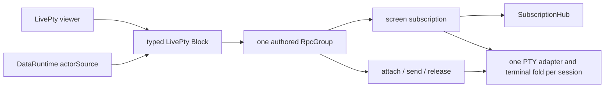
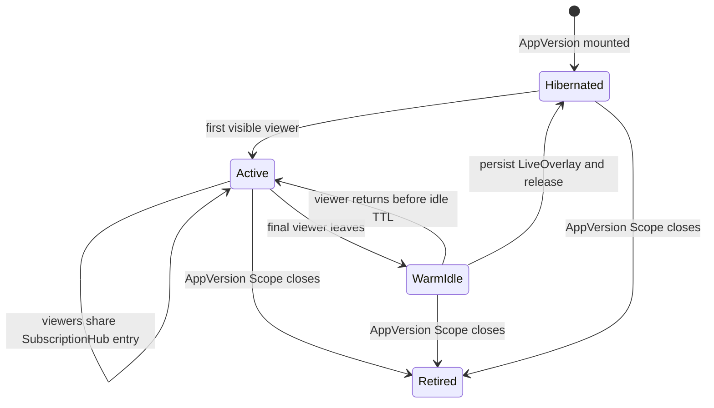

# Provider Resolution — Spec

This document specifies internal Provider resolution for typed domain Blocks. It
builds on [requirements.md](./requirements.md); telemetry-specific rendering is
owned by [05-blocks/05-telemetry](../05-blocks/05-telemetry/spec.md), and
cross-cutting instrumentation by
[05-observability](../../05-observability/spec.md).

## Status

Active.

## Scope

This node defines Provider contracts and implementations, DataBindings and
composition, publish-time Snapshot capture, client resolution, and the
high-level lifecycle of live work. It does not expose a generic data primitive
to App authors: typed domain Blocks are the only public data surface.

```text
typed Block
  -> DataBinding(Operation, args, BindingPolicy)
       -> ProviderContract (*.query.ts, client-safe)
       -> ProviderImplementation (*.provider.ts, server-only)
       -> Snapshot (immutable AppVersion)
       -> DataRuntime (AppVersion-scoped client)
            -> optional LiveOverlay (service-owned)
```

## Provider contract halves (MED.DATA-R46)

The Rpc is the sole operation contract. Payload, success, domain error, stream
shape, middleware, and tag are authored once in `*.query.ts`:

```ts
export interface ProviderContract<Rpcs extends Rpc.Any> {
  readonly id: string
  readonly group: RpcGroup.RpcGroup<Rpcs>
  readonly ops: OperationsOf<Rpcs>
}

export interface Operation<Tag extends string, Args, A, E> {
  readonly providerId: string
  readonly tag: Tag
  readonly rpc: Rpc.Any
  readonly _Args?: Args
  readonly _A?: A
  readonly _E?: E
}

export const contract: <Rpcs extends Rpc.Any>(input: {
  readonly id: string
  readonly group: RpcGroup.RpcGroup<Rpcs>
}) => ProviderContract<Rpcs>
```

`contract` derives one Operation per Rpc tag. An Operation is a client-safe
descriptor; it carries no handler, Layer, credential, filesystem/process
adapter, mutable state, or server capability.

The adjacent `*.provider.ts` imports the ProviderContract and adds behavior:

```ts
export const implement: <Rpcs extends Rpc.Any, R>(
  contract: ProviderContract<Rpcs>,
  input: {
    readonly purity: "pure" | "effectful"
    readonly handlers: HandlersOf<Rpcs, R>
    readonly live?: LiveDriversOf<Rpcs, R>
  },
) => ProviderImplementation<Rpcs, R>

export const mountProvider: <Rpcs extends Rpc.Any, R>(
  implementation: ProviderImplementation<Rpcs, R>,
  layer: Layer.Layer<R>,
) => Effect.Effect<MountedProvider, never, Scope.Scope>
```

Each handler is `(payload) => Effect<Success, Error, R>` or the Rpc's typed
Stream form. Mount constructs `R` once, derives the in-process core and Rpc
handler layer, and registers the Provider under the owning AppVersion Scope.
Dispatch identity is `(owner, localSlug, appVersion, providerId)`. Draft and
published sources discover app-local `providers/*.provider.ts`; their
client-safe contracts live in matching `providers/*.query.ts`.

`vista check` resolves the full client module graph. It rejects `*.provider.ts`,
Node builtins, platform-node integrations, and other server-only modules from
App/client code or the transitive closure of `*.query.ts`, including tunneled
re-exports. Discovery rejects duplicate Provider ids or Rpc tags and any
implementation whose handler set differs from its imported contract.

## Subscription operations and fold/cursor contract (MED.DATA-R46–MED.DATA-R48)

A subscription is an authored stream Rpc plus the client-safe state transition
needed to turn its events into a Snapshot value:

```ts
type Cursor = string

interface SubscriptionOperation<Tag extends string, Args, State, Event, Error>
  extends Operation<Tag, Args, State, Error> {
  readonly kind: "subscription"
  readonly stateSchema: Schema.Codec<State, unknown>
  readonly eventSchema: Schema.Codec<Event, unknown>
  readonly fold: (state: State, event: Event) => State
  readonly cursor: (state: State) => Cursor
}

declare const subscription: <
  Tag extends string,
  Args extends { readonly since?: Cursor },
  State,
  Event extends { readonly _tag: string },
  Error,
>(
  operation: Operation<Tag, Args, Stream.Stream<Event, Error>, Error>,
  contract: {
    readonly stateSchema: Schema.Codec<State, unknown>
    readonly eventSchema: Schema.Codec<Event, unknown>
    readonly fold: (state: State, event: Event) => State
    readonly cursor: (state: State) => Cursor
  },
) => SubscriptionOperation<Tag, Args, State, Event, Error>
```

The underlying Rpc is authored with `stream: true`. Its live request adds an
optional `since: Cursor` resume hint; `since` is transport state, not authored
binding arguments or snapshot-key material. Every event union includes
`{ _tag: "Synced", state }`. A driver that cannot resume a cursor, including an
unknown or expired cursor, emits a full `Synced` event instead of treating the
gap as an empty successful stream.

`stateSchema` defines the folded value stored in the immutable Snapshot and
includes the cursor returned by `cursor(state)`. Each wire event is strictly
decoded with `eventSchema` before the pure, typed `fold` runs. `stateSchema`
strictly decodes Snapshot values and persisted overlays and encodes capture and
hibernation records. Publication invokes the LiveDriver's finite
`initial(args)`, strictly encodes that folded state, and stores one state rather
than event history. Resume, hibernation, client folding, and capture all use
this same fold/cursor contract.

## Command operations and LivePty (MED.DATA-R28–MED.DATA-R31, MED.DATA-R46–MED.DATA-R50, MED.DATA-R79, MED.DATA-R84–MED.DATA-R85)

[Decision 0096](../../.decisions/0096-livepty-uses-screenstate-rpc.md)
realizes MED.DATA-R84–MED.DATA-R85 with one Provider contract for LivePty's
bounded read state and live command plane:



### Command op contract

A `CommandOp` is a typed Rpc-derived Operation that changes live server state
rather than producing captured data:

```ts
interface CommandOp<Tag extends string, Args, A, E>
  extends Operation<Tag, Args, A, E> {
  readonly kind: "command"
  readonly capture: "never"
}

type BindableOperation<Tag extends string, Args, A, E> = Operation<Tag, Args, A, E> & {
  readonly kind?: 'subscription' | 'map' | 'flatMap'
}

declare function bind<Tag extends string, Args, A, E>(
  operation: BindableOperation<Tag, Args, A, E>,
  args: Args,
  policy?: BindingPolicy,
): DataBinding<Args, A, E>
```

The `kind` discriminator makes a `CommandOp` incompatible with
`BindableOperation`, so TypeScript rejects passing one to `bind`. The runtime
`bind` implementation also rejects a command descriptor presented through a
cast or an untyped boundary. Semantic-manifest preflight and publication capture
independently reject command-tagged operations, so an encoded or forged binding
cannot execute a command or contribute a Snapshot entry.

Command ops are dispatched only against a currently mounted Provider. Their
payload, success, and domain error still derive from the authored Rpc and cross
the same strict Schema boundary as data Operations. Only a typed domain Block
may compose command ops with a DataBinding; the generic command surface remains
internal.

### LivePty RpcGroup

The client-safe ProviderContract authors these logical operations:

```text
screen({ session, since? })
  -> Stream<Synced<ScreenState> | CoalescedFrame<ScreenState>>

attach({ session })
  -> AttachLease { leaseId, expiresAt }

send({ session, leaseId, input })
  -> { acceptedAt }

release({ session, leaseId })
  -> { releasedAt }
```

Before resolving any PTY operation, the mounted AppVersion derives the set of
declared PTY sessions from its SemanticManifest bindings. Every operation whose
payload names a session — `screen`, `attach`, `send`, and `release` — is admitted
only when a `pty.screen` binding declares that session id. An undeclared
`screen` id fails with typed `SessionNotDeclared`; command operations fail with
the typed `PtyError` session reason. Service reachability and possession of a
lease id are not resource authority (MED.DATA-R85).

`screen` is a SubscriptionOperation.

Its publish-time value and every `Synced` or `CoalescedFrame` value is a bounded,
strictly decoded `ScreenState` containing the current logical viewport, session
geometry, cursor, terminal modes needed by the renderer, a monotonically
increasing frame cursor, and an observation time. It contains no scrollback or
raw-byte log.

The service owns one upstream PTY adapter and one maintained terminal fold per
live session, reference-shared across AppVersions. PTY output is folded and
coalesced at 16 ms before it enters a SubscriptionHub. Every coalesced frame is
independently renderable, so a newer frame may replace an older unconsumed frame
without corrupting state. Every initial connection and reconnection begins with
`Synced(currentScreenState)`; `since` is a freshness hint, not byte replay.

The adapter consumes the PTY daemon's `GEOMETRY` frame and sizes its fold to that
session-owned geometry. Attach reuses the current session dimensions. There is
no viewer resize command: browsers render the session grid and scroll it when
the block is smaller. The Snapshot remains the current viewport only; humans use
`pty attach` when they need terminal history.

### Trusted actor-source gate

The service exposes one typed `ActorSource` runtime fact through `/health` and
the generated `DataRuntimeProvider` bootstrap:

| `actorSource` | Activation | Meaning |
| --- | --- | --- |
| `none` | Default | The block is read-only, displays explicit read-only provenance, and renders no Attach control |
| `loopback-dev` | `VISTA_LOCAL_VIEWER_IDENTITIES=1` | A loopback-only, HttpOnly viewer cookie supplies a development actor |
| `tailscale` | `VISTA_TRUST_TAILSCALE_IDENTITY_HEADERS=1` | Loopback middleware may derive an actor from Tailscale identity headers |

These two flags are the only actor sources. Tailscale forwarding and ingress
isolation remain unproven, so the Tailscale flag stays an explicit fail-closed
operator opt-in and must not be enabled on the managed service before the T5
identity exercise passes.

The block renders Attach only when `actorSource` is not `none`. This UI gate is
not the authority boundary: data middleware strips caller-supplied trusted
headers and injects both actor and actor source from request context. Provider
commands require both injected values and reject attach server-side when either
is absent or invalid. `AttachLease` is an opaque, short-lived, server-held
single-writer capability bound to actor and session. `send` and `release` fail
closed when actor, session, lease, or expiry does not match. Audit records cover
attach, send, release, denial, expiry, and revocation with actor, AppVersion,
session, operation, outcome, and time; they never contain input bytes.

Before dispatching any command, both mounts enforce one request-boundary policy:

| Request | Required browser intent evidence | Failure |
| --- | --- | --- |
| WebSocket upgrade that can carry commands | `Origin` equals `VISTA_PUBLIC_URL` or an allowed loopback development origin | reject with 403 before upgrade |
| HTTP command | the same allowed `Origin`, plus `Sec-Fetch-Site: same-origin` | reject before Rpc dispatch |
| Read-only HTTP or subscription request | no command-origin requirement | continue through normal AppVersion and binding authorization |

A missing `Origin` therefore denies command dispatch, including for non-browser
clients, while leaving read operations available. The allowed-origin predicate
is shared by the HTTP command middleware and the top-level WebSocket upgrade
dispatcher; Provider implementations cannot bypass or redefine it.

Production release remains gated on a managed Tailscale exercise proving that
trusted viewer identity reaches loopback middleware for both HTTP and
WebSocket upgrade requests and that direct or spoofed identity headers fail
closed. A clean-host exercise must also establish accepted interaction latency
and terminal fidelity; the loaded-host bakeoff establishes relative
architecture, not production thresholds. HTTP fallback remains available when
WebSocket setup fails and does not create a second behavior contract.

### Shipped transport and T5 boundary

The shipped T4 path uses the existing Effect HTTP JSON command transport and
NDJSON subscription transport on the service listener. It does not claim a
WebSocket upgrade route. T5 owns the remaining production-attach work:

| T5 concern | Required result |
| --- | --- |
| WebSocket upgrade owner | One top-level dispatcher routes Provider RPC and Vite HMR upgrades exactly once |
| Identity proof | A managed Tailscale exercise proves HTTP and WebSocket actor forwarding and spoofed direct-ingress rejection |
| Lease UX | Expiry, release-on-disconnect, denial, and deliberate takeover are visible and actionable |
| Persistence cadence | LivePty ScreenState durability is bounded independently of the 16 ms in-memory coalescing cadence |

The unresolved choices are tracked in
[open-questions.md](./open-questions.md): DQ3 owns daemon FOLLOW versus a
privileged bridge, DQ5 lease UX and audit policy, DQ6 fidelity fallback, DQ7
the managed identity-proof surface, DQ8 WebSocket upgrade ownership, and DQ9
persistence cadence.

## Binding policy (MED.DATA-R28–MED.DATA-R30)

```ts
export const BindingPolicy = Schema.Union([
  Schema.Struct({
    mode: Schema.Literal("frozen"),
    effectfulCapture: Schema.optionalKey(Schema.Literal("acknowledged")),
  }),
  Schema.Struct({
    mode: Schema.Literal("live"),
    refreshEvery: Schema.optionalKey(Schema.Number),
    effectfulCapture: Schema.optionalKey(Schema.Literal("acknowledged")),
  }),
  Schema.Struct({
    mode: Schema.Literal("subscription"),
    effectfulCapture: Schema.optionalKey(Schema.Literal("acknowledged")),
  }),
])

export interface DataBinding<Args, A, E, P extends BindingPolicy> {
  readonly operation: Operation<string, Args, A, E>
  readonly args: Args
  readonly policy: P
}

export const bind: (operation, args, policy?) => DataBinding
```

`bind` is Block-internal and defaults policy to `{ mode: "frozen" }`. The
SemanticManifest record is `{ provider, operation, args: encodedArgs, policy }`
and remains attached to the owning SemanticNode.

| BindingMode | Published first paint | Subsequent behavior |
| --- | --- | --- |
| `frozen` | Captured Snapshot value | Never starts live work and has no refresh capability |
| `live` | Captured Snapshot value | Refreshes on explicit policy triggers or cadence |
| `subscription` | Captured folded state and cursor | Connects automatically, catches up, then remains live |

Draft resolution calls the current Provider for every mode. Publication captures
every mode because live and subscription require instant paint and an offline
fallback. A capture that invokes an effectful Provider requires the existing
explicit acknowledgement; mode never implies that acknowledgement.

## Composition rule

| Behavior | Shape | Snapshot rule |
| --- | --- | --- |
| Effectful, dependent, or domain-named behavior | Server Operation | One final-value entry with its own key |
| Pure derivation over captured data | `Operation.map` Projection | No new entry; inherits the source key |
| App-owned dependency graph | `Operation.flatMap` DependentBinding | Constituent entries plus one SemanticManifest edge |

A Projection is browser-safe and deterministic. Its map id, source key, and
projection arguments form only an in-memory atom identity; projection arguments
do not fragment the source Snapshot key. A DependentBinding has a stable
author-declared transform id; runtime-selected values never enter its edge
identity. React render/hook chaining is invalid because semantic extraction has
no Provider values with which to discover the child. A named server Operation
is preferred whenever the composition carries domain policy.

### `Operation.map`: Projection

```ts
Operation.map(source, {
  id,
  payloadSchema,
  successSchema,
  mapArgs: (args) => sourceArgs,
  map: (sourceValue, args) => projectedValue,
})
```

The returned `MappedOperation` is the runtime representation of a Projection.
`mapArgs` is required: projection-only arguments such as a treemap lens must not
fragment or reach the source Operation. Semantic extraction resolves the mapped
binding to its source and captures only that source binding. The Projection has
no Rpc, Provider handler, manifest binding, Snapshot entry, or independently
refreshable value.

The persisted key is the source key. The DataRuntime keeps distinct projected
atoms under:

```text
<map id>::<source snapshot key>::<canonical encoded projection arguments>
```

Refresh forwards to the source atom and reruns the pure map over the resulting
decoded source value. The map module is therefore client-safe, synchronous, and
deterministic; effectful or policy-bearing work is a named server Operation.

### `Operation.flatMap`: DependentBinding

```ts
Operation.flatMap(
  parent,
  (parentValue) => bind(childOperation, childArgs),
  { id, successSchema },
)
```

The returned `FlatMappedOperation` is the runtime representation of a
DependentBinding. Its explicit `id` is stable identity; neither function source
nor selected runtime data is identity. For parent key `P`, the persisted
SemanticManifest dependency is:

```ts
{
  _tag: "flatMap",
  id,
  edge: `${P}::flatMap::${id}`,
}
```

The same semantic evaluation returns a non-persisted `CapturePlan` beside that
manifest. The plan maps this exact edge to its executable selector and is
carried directly into freeze under the owning AppVersion. Duplicate transform
ids for one parent Operation with different selectors fail semantic evaluation;
different AppVersions may use the same id without sharing or overwriting
selectors. No process-global selector registry or module-realm identity is part
of capture.

Freeze validates the edge, captures and decodes the parent, invokes the scoped
selector exactly once, and captures its selected child binding. Snapshot storage
contains the parent and child Operation entries but no redundant derived entry.
On hydration the DataRuntime uses the selector on its own AppVersion operation
descriptor and resolves the resulting child binding. The parent value influences
child arguments but never edge identity.

Changing dependency semantics requires a new transform id. A missing selector,
duplicate transform id, selector defect, edge mismatch, parent decode failure,
or child capture failure fails through the existing typed capture/runtime
channels. React render order and hooks never participate in dependency
discovery.

## Snapshot identity and wire shape (MED.DATA-R29)

Arguments are Schema-encoded before identity is computed:

```ts
export const snapshotKey: (
  operation: Operation<string, unknown, unknown, unknown>,
  encodedArgs: unknown,
) => Effect.Effect<SnapshotKey, CanonicalJsonError>

// sha256(canonicalJson([providerId, rpcTag, encodedArgs]))
```

Canonical JSON recursively sorts object keys, preserves array order, emits only
JSON values, and fails with `CanonicalJsonError` for unsupported or cyclic
values. AppVersion, BindingMode, refresh interval, cursor, capture time, and
schema identity are not key material.

The immutable file has this logical shape:

```ts
interface Snapshot {
  readonly apiVersion: number
  readonly frozenAt: string
  readonly entries: Readonly<Record<SnapshotKey, {
    readonly provider: string
    readonly operation: string
    readonly encodedArgs: unknown
    readonly encodedValue: unknown
    readonly capturedAt: string
  }>>
}
```

Publish encodes arguments and values through the Rpc payload/success Schemas,
rejects duplicate keys with differing encoded material, applies the secret
guards from MED.DATA-R31, self-decodes the complete output, and exposes no
AppVersion unless every required capture succeeds.

The Snapshot envelope, entries, arguments, and values decode with
`onExcessProperty: "error"` and the AppVersion-bundled Schemas. Live responses,
stream events, and persisted overlay records use the same strictness. There is
no operation compatibility version, automatic schema fingerprint, legacy arm,
negotiation, or migration layer. A live/stream mismatch is a typed
`SchemaMismatch`; the frozen value remains visible and the remedy is reload or
re-publication. A mismatched overlay record is discarded and resynchronized.
A missing required frozen entry is `FrozenEntryMissing`, not a live fallback.

## Client DataRuntime

```ts
type Resolved<A> =
  | { readonly _tag: "Frozen"; readonly value: A; readonly frozenAt: string }
  | { readonly _tag: "CatchingUp"; readonly value: A; readonly frozenAt: string }
  | { readonly _tag: "Live"; readonly value: A; readonly observedAt: string }

declare const useBinding: <Args, A, E, P extends BindingPolicy>(
  binding: DataBinding<Args, A, E, P>,
) => AsyncResult.AsyncResult<Resolved<A>, DataError<E>>

declare const useBindingSuspense: <Args, A, E, P extends BindingPolicy>(
  binding: DataBinding<Args, A, E, P>,
) => Resolved<A>
```

One DataRuntime owns one `AtomRegistry` and one
`AtomRpc.Service.runtime` Layer graph per mounted AppVersion. It validates the
Snapshot before installing `ReactHydration.HydrationBoundary`, then hydrates
`Atom.serializable` values through the JSON codec of `AsyncResult.Schema`.
Live unary atoms use `Reactivity` keys; continuously mounted stream atoms use
typed streaming Rpc and ordinary Stream folds. `useRefresh` accepts only live
or subscription bindings at the type level.
Frozen atoms retain their decoded immutable Snapshot seed as their initial value,
so cache eviction and remount reconstruct the same result after hydration
preloads have been consumed; neither an empty state nor live work replaces it.

AsyncResult is the request-state contract: Initial, waiting, Failure,
previousSuccess, and typed Cause stay intact. Resolved is independent domain
provenance; a long-lived subscription may be Live while AsyncResult remains
waiting. Suspense is a thin presentation adapter over the same atom. The
runtime has no module-global snapshots, URLs, atom families, or cursors.

## Live-runtime ownership and hibernation (MED.DATA-R48–MED.DATA-R49)



### SubscriptionHub and shared workers

One `SubscriptionHub` belongs to each AppVersion registry Scope. Its public
operation is:

```ts
subscribe(operation, args, driver, { since? }): Stream<Event, SubscriptionError>
inspect: Effect<ReadonlyArray<SubscriptionHubStatus>>
```

The hub is the `subscription`-mode server runtime. A `live` binding remains a
request-scoped unary AtomRpc call with client refresh/cadence; it has no
LiveDriver, SubscriptionHub entry, or persisted LiveOverlay. The mounted
Provider dispatch admits every live unary call through the shared
ProviderBudget before invoking its ordinary handler.

The hub owns an `RcMap` keyed only by snapshot key. All viewers of the same
binding therefore share one LiveDriver and folded state; different AppVersions
do not share workers. The final viewer's shared-stream Scope closes the upstream
immediately, while the `RcMap` deliberately retains the folded resource for its
idle TTL. The default TTL is 30 seconds. A return during that window reuses the
warm entry; expiry finalizes it. A `SubscriptionRef` holds current folded state
and changes. `Stream.share({ capacity: 16, strategy: "sliding", replay: 0 })`
fans the one pollable or subscribable upstream out to viewers and stops it at
zero subscribers. The explicit viewer count controls adaptive poll cadence and
status. The `RcMap` default capacity is 1,024 binding resources per AppVersion.

The AppVersion Scope is the hard teardown boundary. Replacement publication,
retirement, and draft close interrupt workers and subscribers even while a key
is borrowed and persist the latest valid overlay. The service-owned
ProviderBudget outlives individual AppVersion Scopes. The immutable AppVersion
directory is never changed.

### LiveOverlay persistence and wake

The service persists this strict Schema through `KeyValueStore.SchemaStore`:

```ts
type LiveOverlay<State> = {
  readonly state: State
  readonly cursor: Cursor
  readonly observedAt: DateTime.Utc
}

// logical durable entry
(appVersionId, snapshotKey) -> LiveOverlay
// encoded store key
`${appVersionId}::${snapshotKey}`
```

`VISTA_LIVE_STATE` selects the store root; the service default is
`${VISTA_CACHE}/live-state`. Every accepted event best-effort persists the
latest folded state, cursor, and observation time; hibernation finalization
writes the last value again and records `persisted` or `failed`. Wake strictly
decodes both the record envelope and `state` with
`onExcessProperty: "error"`, serves a valid overlay immediately, and resumes
the LiveDriver from the stored cursor. Missing records obtain a fresh initial
state. Malformed or contract-incompatible records are removed, record
`corrupt-discarded`, and resynchronize through the driver. There is no legacy
decoder or partial overlay fallback.

### Provider budget policy

The standing `ProviderRegistryManager` creates one `ProviderBudget` and lends it
to every AppVersion hub and mounted Provider. Remote Providers share a
per-provider token-bucket RateLimiter (`60` acquisitions per minute by default,
`onExceeded: "delay"`). Local Providers share a per-provider Semaphore with
four permits. Admission covers both subscription-driver upstream calls and
request-scoped live unary handlers, records remaining tokens and bounded
throttle delay under resource `live`, and never creates an AppVersion-local
allowance.

A pollable LiveDriver declares minimum and maximum intervals. `ProviderBudget`
first derives viewer cadence as
`max(min, floor(max / min(max(1, v), 4)))`; more than four active viewers do
not accelerate it further. Local Providers use that cadence directly. For a
remote Provider, the budget also derives quota cadence from its last
`RateLimiter` remainder:
`floor(max - (max - min) * clamp(remaining / limit, 0, 1))`, defaulting
`remaining` to the configured limit before the first admission. The effective
cadence is the slower `max(viewerCadence, quotaCadence)`, so viewer pressure
speeds polling toward the minimum while quota pressure slows it toward the
maximum. `Stream.share` closes the worker at zero viewers, so the warm idle TTL
performs no upstream calls. Any remaining throttle delay is still enforced by
the shared limiter and never becomes an AppVersion-local allowance.

### NDJSON stream route

Unary and stream Rpcs both `POST` to the Provider's same-origin
`/_data/<providerId>` endpoint. `Content-Type: application/json` selects the
`RpcSerialization.layerJson` Provider handler for unary Operations;
`Content-Type: application/ndjson` selects the
`RpcSerialization.layerNdjson` handler for SubscriptionOperations. Keeping one
Provider URL preserves the Rpc-first contract while NDJSON supplies progressive
framing for the open stream. Rpc/Schema owns request, event, error, framing, and
cancellation decoding.

Under a Vista App route the endpoints are:

```text
/r/<encoded-owner>/<local-slug>/draft/_data/<providerId>
/r/<encoded-owner>/<local-slug>/vN/_data/<providerId>
/r/<encoded-owner>/<local-slug>/latest/_data/<providerId>
```

Draft preserves the authored BindingPolicy but resolves every mode against the
current Provider; a draft subscription still uses the hub and visibility
lifecycle. Receipt-verified pinned and follow-latest routes first paint their
captured folded state. Only `live` and `subscription` then acquire live work;
`frozen` never opens a data route. `latest` resolves to its current AppVersion
before hub lookup, while a pinned `vN` remains bound to that version.

### Browser visibility and reconnect protocol

The subscription atom paints `Resolved.Frozen`, switches to
`Resolved.CatchingUp`, and opens the typed NDJSON Rpc stream with
`since: cursor(snapshotState)`. Each accepted event is strictly decoded and
folded before the atom becomes `Resolved.Live`; it invalidates the Reactivity
key `[providerId, tag, snapshotKey]`. A transport failure remains
typed and a decode defect becomes `SchemaMismatch`; either retains the last
valid value through `AsyncResult.previousSuccess`.

The per-AppVersion `AtomRpc.Service` runtime supplies the registry-local client
Layer, while the subscription consumes the flattened `RpcClient` stream
directly; the demand-driven `AtomRpc.stream` pull atom is not the continuous
subscription primitive.

When `document.visibilityState` becomes `hidden`, the registry-local visibility
atom switches the subscription to `Stream.never`, gracefully closing the server
viewer Scope. On `visible`, it reconnects with the last accepted cursor. An
explicit refresh performs the same close-and-reconnect immediately. Visibility,
cursor, stream fiber, and cleanup remain local to the mounted AppVersion's
AtomRegistry.

## Security and authority (MED.DATA-R31)

Provider routes remain same-origin and receipt/AppVersion scoped at
`/r/<encoded-owner>/<local-slug>/<version>/_data/<providerId>`. Arguments and
results are strictly Schema-decoded, and the mounted registry determines the
only callable Provider ids and tags. Credentials, Layers, handlers, raw
commands, and service configuration remain server-side. Snapshot capture
rejects Schema-branded sensitive values and scans the encoded result as a
backstop.

## Open design questions

- **DQ1 — Cross-AppVersion worker sharing:** May compatible AppVersions share
  active upstream execution while preserving separate authorization, Scope,
  overlay, retention, and telemetry ownership? Resolution requires a keyed
  leasing design that cannot let one version extend another's lifetime.
