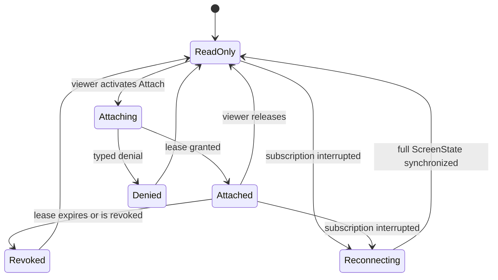

# Terminal Block — Spec

This document specifies the `LivePty` Block realization. It builds on
[requirements.md](./requirements.md) and the generic LivePty Provider contract in
[../../03-data-sources/spec.md](../../03-data-sources/spec.md).

## Status

Active.

## Scope

This node owns bounded terminal viewport rendering, the viewer-facing attach
experience, keyboard/focus behavior, accessible status, and Storybook states. It
does not define PTY transport, folding, AppVersion authorization, lease policy,
or audit persistence; those remain in `03-data-sources`.

```text
fixed LivePty props
  -> declared pty.screen binding
  -> captured ScreenState
  -> read-only viewport + subscription
  -> explicit Attach
  -> bounded writer lease
  -> gated input + resize
```

## Typed authoring surface

```ts
interface LivePtyProps {
  readonly id: string
  readonly label: string
  readonly sessionId: string
  readonly height?: number
}
```

`sessionId` is fixed author input. Rendering the Block declares the
`pty.screen({ session: sessionId })` binding captured into the AppVersion's
SemanticManifest; it is not supplied or replaced by the viewer. `height`
constrains the viewport and does not imply scrollback. The Block exposes neither
a generic Operation nor command payload props.

## View and attach states

The Block state machine is explicit:



Every state renders the most recent valid bounded `ScreenState`; a transport or
Schema failure retains the captured/current viewport and marks it degraded.
Only `Attached` enables terminal input and resize. `ReadOnly`, `Attaching`,
`Denied`, `Revoked`, and `Reconnecting` cannot dispatch `send` or `resize`.
Release returns immediately to read-only UI even while the server response is
pending; a failed release remains visibly revoked rather than restoring local
write controls.

The attach control names the session label and the authority being requested.
The attached state identifies the active writer lease and exposes an explicit
Release action. Denial, expiry, revocation, connection loss, and recovery are
visible statuses, not silent disabled controls.

## Rendering and accessibility

`LivePty` renders the complete logical viewport from `ScreenState`: rows,
columns, cells, cursor, and supported terminal modes. New frames replace the
bounded viewport atomically; the component does not replay bytes or synthesize
scrollback.

The viewport has an accessible name derived from `label`. Connection and lease
changes are announced through a polite status region without announcing
terminal output. Attach and Release are ordinary focusable buttons outside the
terminal surface. Entering attached mode does not steal focus automatically.
When the viewer focuses the terminal, an advertised escape chord returns focus
to the Block controls; the Block must not create a keyboard trap. Status is
conveyed by text and semantics as well as color. Reduced motion disables any
cursor/status animation that is not essential to terminal meaning.

Resize is emitted only while attached and only from measured viewport geometry;
passive layout changes never claim geometry ownership. Input events are sent as
bounded command batches and never copied into UI telemetry or audit content.

## Storybook contract

The shared Storybook includes focused stories for:

| Story | Observable contract |
| --- | --- |
| Read-only captured | captured viewport paints; input and resize are unavailable |
| Catching up / live | provenance and connection state are distinct from lease state |
| Attaching | request is pending and duplicate attach is unavailable |
| Attached | input, resize, and Release are available |
| Denied | typed denial is explained and terminal remains read-only |
| Revoked / expired | writer controls disappear and focus can return to controls |
| Disconnected / reconnecting | last viewport remains, degraded state is explicit, synchronized recovery returns read-only |
| Light/dark and narrow viewport | Geist tokens, readable contrast, bounded layout, and no implied scrollback |

Keyboard stories exercise Attach, terminal focus, the escape chord, Release, and
focus recovery. Accessibility checks cover the viewport name, live status,
button names, non-color state communication, and absence of a keyboard trap.

## Explicit exclusions

The first realization is viewport-only. It provides no raw byte stream,
scrollback/history, arbitrary session picker, generic Provider explorer, generic
command console, file transfer, clipboard synchronization, App/document edits,
or publication mutation. Adding one of these capabilities requires its own
requirement and authority review; it cannot be inferred from `LivePty`.
