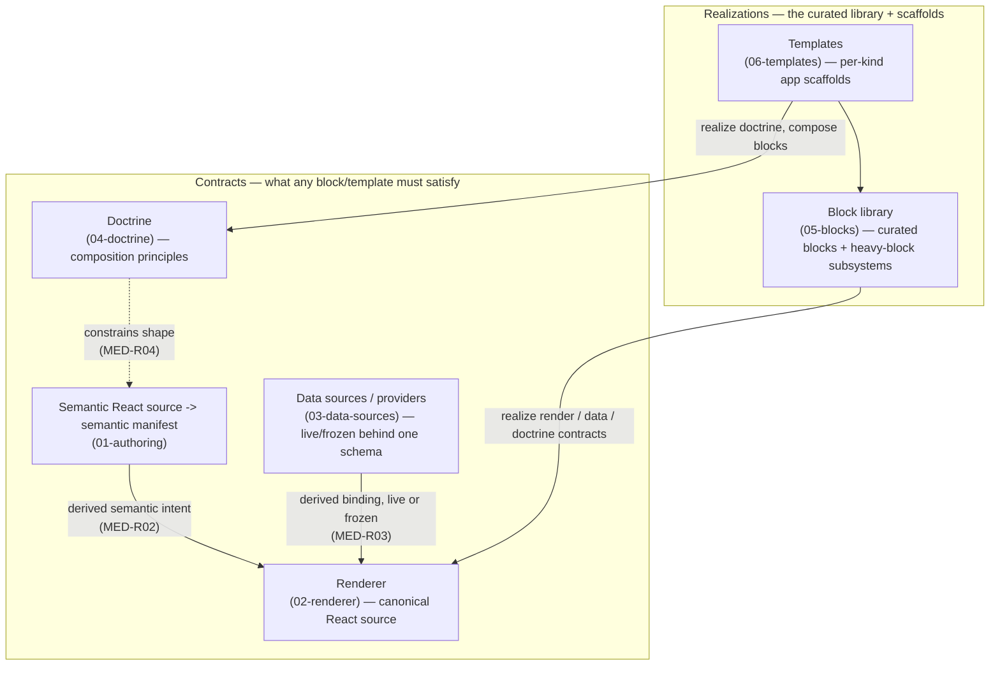

# Medium Spec (composition)

How the app medium is composed from its six children — **four contracts** and **two
realizations** (decision 0067). This document is the composition map; the mechanisms
live in each child spec. It builds on [requirements.md](./requirements.md) and the
root architecture map [../spec.md](../spec.md); terms per [../ontology.md](../ontology.md).

## Status

Draft. Detail and open items live in each child spec and the root
[open-questions.md](../open-questions.md).

## Composition

The **semantic React source (01-authoring)** is the UI source of truth. Vista
derives its portable semantic manifest for doctrine, indexing, bounded-choice
targeting, and freezing (MED-R01). The **renderer (02-renderer)** renders that
source and preserves full manifest/DOM correspondence (MED-R02). **Providers
(03-data-sources)** satisfy semantic data bindings derived from typed JSX props,
live at view time or frozen at publish, through one schema (MED-R03). **Doctrine
(04-doctrine)** constrains the App's shape through semantic primitives and an
advisory linter (MED-R04).

The two **realization** layers satisfy those contracts. The **block library
(05-blocks)** realizes the render/data/doctrine contracts as a versioned,
Storybook-incubated library — with six heavy blocks (code, mermaid, system-explorer,
treemap, telemetry, fork) as child subsystems, each refining the contracts it uses.
**Templates (06-templates)** realize doctrine as per-kind app scaffolds that compose
blocks. A realization requirement `refines:` whichever contract it specializes, which
is what makes a vertical block/template subsystem composable over the horizontal
contracts.

## Where the detail lives

- **[01-authoring/spec.md](./01-authoring/spec.md)** — one ordinary React App
  component, trusted publish-time semantic evaluation, the derived manifest, and
  the curation path.
- **[02-renderer/spec.md](./02-renderer/spec.md)** — canonical React rendering,
  manifest/DOM equivalence, and derived data/runtime bindings.
- **[03-data-sources/spec.md](./03-data-sources/spec.md)** — the generic provider
  contract (Schema spine, two-tier `@effect/rpc`, `RpcGroup`/`core` split, Vite-SSR
  mount, the live⇄frozen keystone).
- **[04-doctrine/spec.md](./04-doctrine/spec.md)** — the composition principles
  (ask-first, status buckets, evidence reachable) and the advisory slop linter.
- **[05-blocks/spec.md](./05-blocks/spec.md)** — the full block roster, packaging /
  Storybook / Geist, and the heavy blocks (code, mermaid, system-explorer, treemap,
  telemetry, fork) as child subsystems (incl. the Grafana telemetry island).
- **[06-templates/spec.md](./06-templates/spec.md)** — the per-kind body doctrine,
  how a template composes blocks, `vista new`, and the design-interview round-trip.

Cross-cutting concerns that sit above the medium — service hosting/URLs/lifecycle,
the visual system, packaging, and the runtime-policy projection — live in the root
[../spec.md](../spec.md) and [01-service](../01-service/requirements.md).
