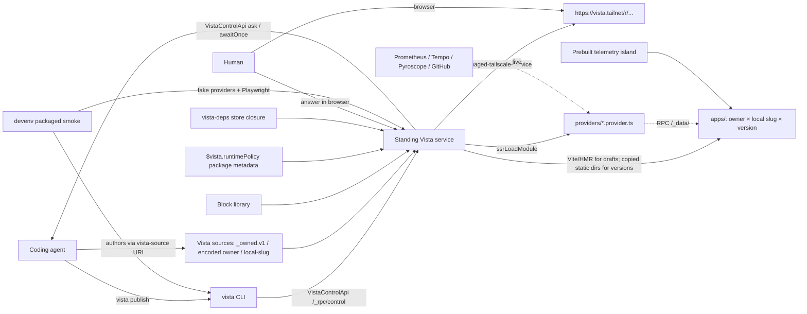

# Vista Spec

System-level **architecture map** for Vista: the composition of its layered nodes,
the invariants that bind them, and the cross-cutting visual system. Subsystem-level
mechanism lives in each node's own `spec.md` (see [Subsystem specs](#subsystem-specs)).
Synthesizes the mechanisms decided in [.decisions/](./.decisions/) and evidenced in
the subsystem `.experiments/`. Builds on [vision.md](./vision.md) and
[requirements.md](./requirements.md); terms per [ontology.md](./ontology.md).

## Status

Draft. Subsystem mechanism lives in each node's `spec.md` (see
[Subsystem specs](#subsystem-specs)); open implementation details are tracked in
[open-questions.md](./open-questions.md) and current drift in [.delta/](./.delta/).

## Architecture

Composition invariants:

| Component             | Role                                                                                                                                                                                                                                                          |
| --------------------- | ------------------------------------------------------------------------------------------------------------------------------------------------------------------------------------------------------------------------------------------------------------- |
| Coding agent          | Authors app content in its owner-scoped `VISTA_SOURCES/_owned.v1/<encoded-owner>/<local-slug>` source; thin surface (decisions 0002, 0077)                                                                                                                    |
| `vista` CLI           | The agent's only operational surface: one required owner-scoped `publish`; optional scaffold, rehydrate, lifecycle, and inspection helpers target the same identity (AGT.CLI-R06, decisions 0028, 0077)                                                       |
| Standing service      | Hosts draft HMR, builds once at publish, and serves only receipt-backed immutable static directories; receiptless versions fail closed without Vite fallback (decisions 0002, 0017, 0028, 0075)                                                               |
| Renderer              | Renders canonical semantic React source while preserving complete manifest/DOM equivalence and derived data/runtime bindings (MED.REND-R02–R04, decisions 0074/0076)                                                                                          |
| Block library         | Curated, versioned semantic React components; every Vista-owned block and shell surface is fully StyleX-authored over Geist semantic tokens (MED.BLK-R01/R07/R26/R27/R48)                                                                                     |
| Provider              | Server-side data peer satisfying a semantic binding through effect Schema/RPC (decision 0027)                                                                                                                                                                 |
| Runtime policy        | Package-derived Vite/import policy consumed by the standing service; it is infrastructure composition, never an App-authored registry (decisions 0044, 0048)                                                                                                  |
| `vista-deps` closure  | One read-only Nix store closure shared by service + apps (0017)                                                                                                                                                                                               |
| Telemetry island      | Prebuilt self-contained Grafana island (its own bundled React 19 instance) consumed by React-19 telemetry blocks; frozen versions pin the content-addressed chunk; Buck builds it without a FOD (decisions 0040, 0043, 0046, 0050)                            |
| Packaged smoke        | Devenv task that builds/accepts the Nix package, runs packaged CLI/service against isolated mutable roots, and proves browser/live-telemetry/runtime-policy boundaries (decisions 0048, 0049)                                                                 |
| Source-worktree tests | Both service lanes depend on `vista:changelog:build`, which compiles the authored changelog with the canonical service build identity; each lane supplies that artifact through `VISTA_CHANGELOG_MANIFEST` without relaxing the required production companion |

## Visual system

Vista uses the Geist-native visual system through StyleX (decision 0036 as
amended). The block library consumes `@overeng/geist-design-system` semantic
tokens and components, defaults Storybook and published App shells to dark, and
supports an explicit light theme class. Vista defines no separate brand accent:
grayscale is the baseline and hue is reserved for semantic meaning.

Every Vista-owned block and shell surface uses co-located StyleX. Shared/public
components expose constrained typed root or slot style contracts where needed.
Tailwind utilities and Vista-owned global/component stylesheets are absent from
the completed block surface. A third-party renderer whose markup cannot receive
StyleX classes may retain one named, narrowly scoped stylesheet seam; that seam
must consume the same Geist tokens and preserve dark/light behavior.

Shell chrome and common controls use Geist components where available. App
blocks remain Vista-domain components while consuming Geist density, typography,
border, radius, focus, and semantic-color tokens. Storybook remains the visual
regression and incubation surface, with contract-relevant dark/light,
interaction, responsive, and failure coverage.

## Subsystem specs

This root spec is the **architecture map only** — the composition diagram, the
invariants table, and the cross-cutting visual system. Every subsystem-level
mechanism lives in its owning node's `spec.md`:

| Node              | Spec                                                                                                                                      |
| ----------------- | ----------------------------------------------------------------------------------------------------------------------------------------- |
| Service substrate | [01-service/spec.md](./01-service/spec.md)                                                                                                |
| The app medium    | [02-medium/spec.md](./02-medium/spec.md) → authoring / renderer / data-sources / doctrine (contracts) + blocks / templates (realizations) |
| Agent interface   | [03-agent-interface/spec.md](./03-agent-interface/spec.md) → cli / skill                                                                  |
| Feedback (staged) | [04-feedback/spec.md](./04-feedback/spec.md) → interview                                                                                  |
| Observability     | [05-observability/spec.md](./05-observability/spec.md)                                                                                    |
| App Resource      | [06-app-resource/spec.md](./06-app-resource/spec.md)                                                                                      |
| Version Resource  | [07-version-resource/spec.md](./07-version-resource/spec.md)                                                                              |
